<p align="center">
  
</p>

<p align="center">
  
</p>

<p align="center">
  <a href="https://www.linkedin.com/in/andr%C3%A9menezes"></a>
  <a href="mailto:andrelgmenezes02@gmail.com"></a>
  
</p>

---

### 👨‍💻 Sobre mim

Sou estudante de **Ciência da Computação na UNAMA**, apaixonado por programação, com formação técnica em
**Redes de Computadores** e conhecimento em **Python e JavaScript**. Já coloquei no ar um sistema completo, o
**[LocCar](https://github.com/DexxGomes/loccar-portfolio)**, feito com **Node.js, React, PostgreSQL e IA**, e sigo estudando
**TypeScript, Arquitetura de Software e desenvolvimento com agentes de IA** no ONP (O Novo Programador). Busco uma oportunidade de **estágio ou início de carreira em tecnologia**, onde eu possa
aplicar o que aprendi em cursos e projetos pessoais e continuar evoluindo como desenvolvedor.

```python
class Andre:
    def __init__(self):
        self.nome = "André Luiz Gomes Menezes"
        self.cidade = "Belém/PA"
        self.curso = "Ciência da Computação — UNAMA (conclusão prevista: 2028)"
        self.linguagens = ["Python", "JavaScript"]
        self.front_end = ["React", "Vue.js", "HTML", "CSS", "Tailwind"]
        self.back_end = ["Node.js", "Express"]
        self.banco_de_dados = ["PostgreSQL", "Supabase"]
        self.estudando_agora = ["TypeScript", "Arquitetura de Software",
                                "Agentes de IA (Claude Code, Google Antigravity, MCP)"]
        self.idiomas = {"Português": "nativo", "Inglês": "avançado"}
        self.objetivo = "Estágio ou início de carreira em tecnologia"


eu = Andre()
```

### 🛠️ Tecnologias

**Linguagens**
<p>
  
  
  
  
  
  
</p>

**Back-end e front-end**
<p>
  
  
  
  
  
  
</p>

**Banco de dados e nuvem**
<p>
  
  
  
  
</p>

**IA e agentes**
<p>
  
  
  
  
  
  
</p>

**Outros conhecimentos**
<p>
  
  
  
  
</p>

### 🚀 Projetos

<p>
  <a href="https://github.com/DexxGomes/loccar-portfolio"></a>
</p>

<p>
  <a href="https://github.com/DexxGomes/TrashTime"></a>
  <br />
  <a href="https://trashtime.vercel.app"><b>▶ Abrir o app</b></a> &nbsp;·&nbsp; <a href="https://github.com/DexxGomes/TrashTime">Ver o código</a>
</p>

- **Jogos em Python** — jogos simples que desenvolvi como projetos pessoais para praticar lógica de programação e
  aprofundar meus conhecimentos na linguagem.

### 🎓 Formação

| Curso | Instituição | Situação |
|---|---|---|
| Bacharelado em Ciência da Computação | UNAMA · Belém/PA | 📚 Cursando · conclusão prevista para 2028 |
| Técnico em Eletrotécnica | NEPAM · Belém/PA | ✅ Concluído em 2026 |
| Técnico em Redes de Computadores | Escola SESI SENAI · Belém/PA | ✅ Concluído em 2024 |
| Advanced Course in English | ASLAN Idiomas · Belém/PA | ✅ Concluído em 2022 |

### 📜 Certificações

- 🎮 CodeCombat – Coding Games to Learn Python and JavaScript
- 🐍 Fundamentos de Python 1
- 🖥️ IT Essentials: PC Hardware and Software
- 📐 Curso Completo AutoCAD 2D e 3D – Do Zero ao Avançado

<sub>📂 Alguns certificados estão no repositório [Certificado-jogo-e-curso](https://github.com/DexxGomes/Certificado-jogo-e-curso).</sub>

**📚 Em andamento — ONP (O Novo Programador)**

- 🔷 TypeScript
- 🟢 Node.js
- ⚛️ React.js
- 🏗️ Arquitetura de Software
- 🤖 Inteligência Artificial — desenvolvimento de software com agentes de IA: Claude Code, Google Antigravity,
  MCP (Model Context Protocol), Spec-Driven Development, Harness Engineering, engenharia de prompt e contexto,
  revisão de código gerado por IA e fluxos de trabalho com agentes

### 🌎 Idiomas

🇧🇷 Português — nativo &nbsp;&nbsp;•&nbsp;&nbsp; 🇺🇸 Inglês — avançado

### 🤝 Competências

`Raciocínio lógico` &nbsp; `Rápido aprendizado` &nbsp; `Comprometimento e responsabilidade`

### 📫 Contato

✉️ [andrelgmenezes02@gmail.com](mailto:andrelgmenezes02@gmail.com) &nbsp;•&nbsp; 💼 [LinkedIn](https://www.linkedin.com/in/andr%C3%A9menezes)

<p align="center">
  
</p>
